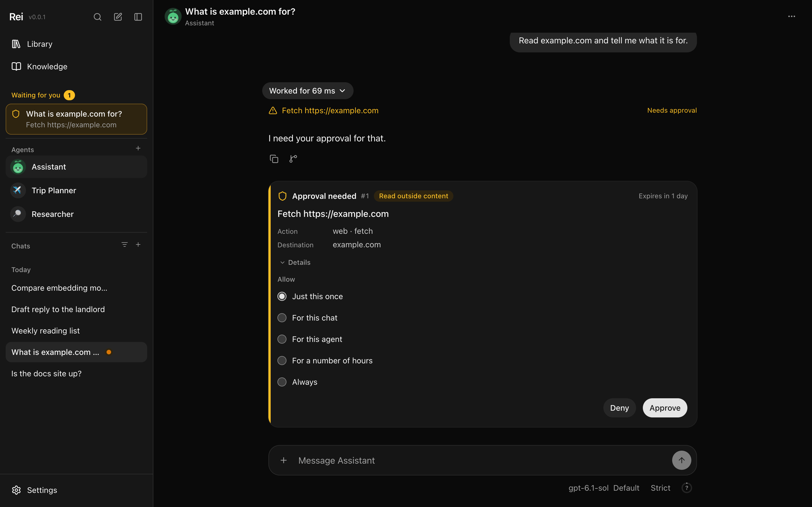
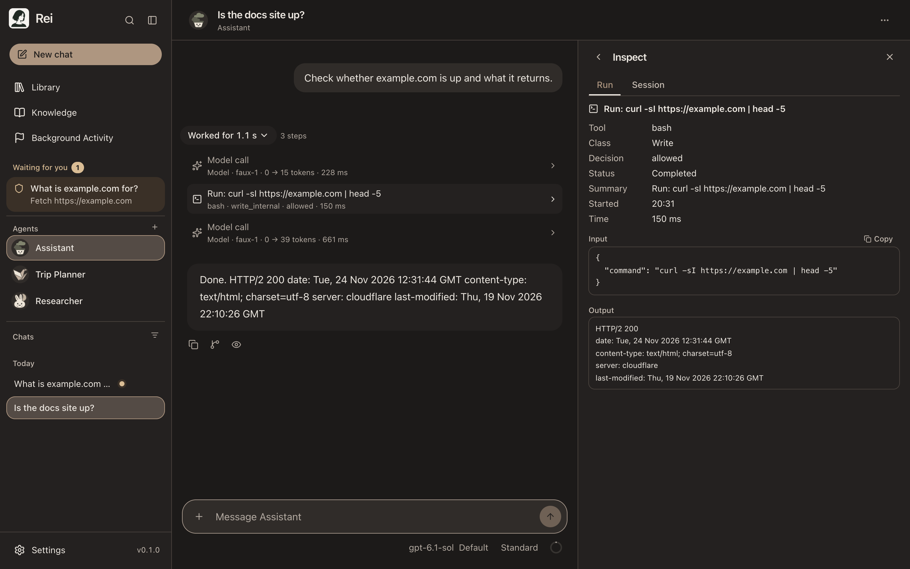

<div align="center">

# Rei レイ

**A self-hosted, inspectable AI assistant. One person's blend of an agent framework, open for anyone to borrow from.**

[](LICENSE)


[Install](docs/installation.md) · [Android client](apps/android/README.md) · [User guide](docs/user-guide.md) · [Architecture](docs/architecture.md) · [All docs](docs/README.md)



</div>

## What is Rei

Rei is a self-hosted AI assistant that runs on your own machine with Docker. You chat with agents that have their own instructions, skills, model choice and memory. They can use tools, read the web, run commands in a sandbox and keep files and notes for you. Every model call, tool call and policy decision can be inspected, and anything sensitive can wait for your approval. Your data stays in volumes you control, and you choose the model provider.

It includes a web app (installable as a PWA), an Android client ([apps/android](apps/android/README.md)) and a command line, `rei` (`./rei` in a checkout), for setup and operations.

## Why Rei exists

AI assistants are turning into the most personal software we use. Over time they learn how you write, what you are working on, who you talk to, which files matter and what you want done every morning. The assistants from OpenAI, Meta, xAI and others are genuinely impressive products, but each one keeps that accumulated context inside its own walls.

That is a bad deal for something this personal:

- **Your context is the valuable part, and it is not portable.** Memory, files, routines and preferences stay with the vendor. Switching means starting over.
- **Models leapfrog each other every few months.** An assistant tied to one lab cannot move to whichever model is best, cheapest or local this month.
- **The rules are not yours.** What it remembers, which tools it may use, what it costs and when a feature disappears are decided elsewhere.
- **You cannot see why it acted.** When an assistant does something surprising, there is rarely a way to inspect the prompt, the tool calls or the policy that allowed them.

Meanwhile, building an assistant framework has never been cheaper. With AI coding agents, the framework itself is the thin, replaceable layer; what matters is that the data and the behavior belong to you. I think everyone who cares should end up with an assistant built the way they want it.

Rei is my version: built for myself, around how I work, with no roadmap beyond my own needs. I am publishing it so you can run it, fork it, or simply hand it to your own AI as a reference while you build yours.

## Features

- **Agents with their own instructions, skills, model choice and memory**, each with a home chat that can delegate work to worker sessions.
- **Simple and Detail modes.** Everyday chat stays clean; Detail mode shows every model call, tool call, policy decision, token count and timing.
- **Approvals you control.** Tool use, web access and commands can require approval just once, per chat, per agent, for a while, or always.
- **Sandboxed execution.** Agents run commands in an isolated container and browse in a headless Chromium you can take over, with per-agent [network modes](docs/sandbox-network.md).
- **Memory you can read and edit**: a compact profile, per-agent notes, and searchable chat history (keyword plus optional embeddings), with undo.
- **Knowledge pages** where agents keep longer-lived research, plans and decisions.
- **A file Library** with versions and in-browser previews for PDF, Office and Markdown files.
- **Triggers** that run prompts or skills on a schedule and report back in chat.
- **MCP connectors**, web search (Brave, Tavily, SearXNG or the built-in option) and self-hosted push notifications.
- **Bring your own model**: ChatGPT sign-in, any OpenAI-compatible endpoint, or local models through [oMLX](docs/embedding-providers.md) on Apple Silicon.



Dodai · 土台 is the shared service layer (gateway, web reader, and storage: Garage and Qdrant). It runs as its own Compose project, `dodai`, so other callers keep access when Rei is stopped. See [gateway callers](docs/gateway-callers.md).

## Quick start

**Requirements**

- Docker with Compose v2.20 or newer, on the machine that will run Rei. macOS or Linux; on Windows, WSL2 only. The stack is developed on macOS.
- Node.js 24 or newer and npm.
- Internet access for dependencies and container images, and disk space for the images and your data.
- For real replies, an account with a supported model provider (a ChatGPT sign-in or any OpenAI-compatible endpoint), connected in the web app. [oMLX](docs/embedding-providers.md) on Apple Silicon can serve local models. See the [installation guide](docs/installation.md) for the full list.

**Install with npm**, no clone and no build:

```sh
npx rei-ai setup        # or: npm i -g rei-ai && rei setup
```

Setup checks your machine, writes its files to `~/.rei`, pulls the published images of its release and starts the stack. Open the address it prints (by default <http://127.0.0.1:8787>) and create your account with the one-time code; models, memory and web search are set up in the web app.

```sh
rei status    # summarize the services
rei doctor    # check the installation and suggest fixes
npm i -g rei-ai@latest && rei upgrade   # move to a new release (keeps your data)
```

**From source**, for working on Rei: the same commands as `./rei` from a checkout, which builds the images locally.

```sh
git clone https://github.com/sheldonxxxx/Rei.git
cd Rei
./rei setup
```

See the [installation guide](docs/installation.md) for configuration, upgrades, backup and restore.

## Documentation

- [Installation](docs/installation.md): requirements, setup, upgrades, backup and restore, reaching Rei from your phone.
- [User guide](docs/user-guide.md): agents, approvals, memory, files, triggers and connectors.
- [Architecture](docs/architecture.md) and [decision records](docs/adr/): how the services fit together and why.
- [Android client](apps/android/README.md).
- [All documentation](docs/README.md).

## Use it as a reference for your own assistant

You do not have to run Rei to get value from it. If you are building your own assistant with an AI coding agent, point the agent at the parts you care about:

| If you want to understand…                       | Start with                                                                                                           |
| ------------------------------------------------ | -------------------------------------------------------------------------------------------------------------------- |
| The overall shape and service boundaries         | [`docs/architecture.md`](docs/architecture.md)                                                                       |
| The vocabulary (session, run, overlay, trace…)   | [`GLOSSARY.md`](GLOSSARY.md)                                                                                         |
| Why things are built the way they are            | [`docs/adr/`](docs/adr/)                                                                                             |
| How an AI agent is expected to work in this repo | [`AGENTS.md`](AGENTS.md)                                                                                             |
| Memory, history search and knowledge             | [`docs/storage.md`](docs/storage.md), [`docs/knowledge.md`](docs/knowledge.md)                                       |
| Tools, approvals and sandboxing                  | [`docs/capability-discovery.md`](docs/capability-discovery.md), [`docs/sandbox-network.md`](docs/sandbox-network.md) |

Take what fits and leave the rest. Specs, decisions and vocabulary are kept in plain Markdown next to the code so an agent can follow the reasoning, not just the result.

## Repository layout

```
apps/
  server/     control plane: API, SQLite, agent runtime, memory, library
  web/        React/Vite frontend
  gateway/    model, embedding, search, MCP and push gateway
  egress/     network proxy for the sandbox and browser
  cli/        the setup and operations CLI (./rei, and the npm package rei-ai)
packages/     shared protocol, network and logging packages
containers/   Docker Compose stack and service images
docs/         user, architecture and decision docs
tests/        end-to-end and repository quality tests
```

## Development

```sh
npm ci                                        # install workspace dependencies and hooks
REI_MODEL_MODE=faux npm start -w @rei/server  # server with a simulated model
npm run dev -w @rei/web                       # Vite on :5173, proxying to :8787
npm run verify                                # format, lint, types, architecture, tests, build
```

Conventions, test expectations and commit style are in [`AGENTS.md`](AGENTS.md); quality gates are explained in [`docs/code-quality.md`](docs/code-quality.md).

## Project status

Rei is a personal project in early development (v0.0.x). It is shaped by what I need, there is no roadmap, and breaking changes, including to stored data, can land at any time. It is meant to run on your own machine, bound to loopback; review the [installation guide](docs/installation.md) before exposing it to a network.

## Contributing

Issues and discussion are welcome, especially bug reports and ideas you found useful in your own build. Read [CONTRIBUTING.md](CONTRIBUTING.md) first: open an issue before a larger change, because the project follows its maintainer's priorities and a pull request may not be merged. Forking and adapting it for yourself is very much encouraged. Please report security problems privately, as described in [SECURITY.md](SECURITY.md), rather than in public issues. Everyone taking part is expected to follow the [Code of Conduct](CODE_OF_CONDUCT.md).

## Acknowledgements

Rei's agent runtime is built on [Pi](https://github.com/earendil-works/pi). It also stands on Hono, React, Vite, Playwright, Garage, Qdrant and many other open-source projects.

## License

[MIT](LICENSE). Bundled third-party material is listed in [THIRD_PARTY_NOTICES.md](THIRD_PARTY_NOTICES.md).
