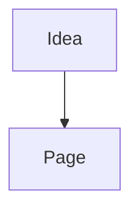

# Markdown Rei renders

Every example below renders as structure. Anything else shows as plain text.

## Headings and text

````markdown
## Heading
Plain text with **strong**, *emphasis*, ~~struck~~ and `code`.
````

## Lists and tasks

A task item starts with `[ ]` or `[x]`. `@agent` mentions an agent and `📅 YYYY-MM-DD` sets a due date; both render as chips in task items only.

````markdown
- first point
- second point

1. step one
2. step two

- [ ] Check the numbers @researcher 📅 2026-12-01
- [x] Draft the summary
````

## Tables

````markdown
| Option | Cost |
|:-------|-----:|
| A      | 10   |
| B      | 12   |
````

## Code

Add a language after the fence so the code is highlighted.

`````markdown
```ts
const total = items.length;
```
`````

A `mermaid` fence is drawn as a diagram (flowcharts, sequence diagrams and so on); if it has a syntax error the reader sees the code instead, so keep it simple.

`````markdown

`````

## Callouts and toggles

Kinds: NOTE, TIP, IMPORTANT, WARNING, CAUTION. A trailing `-` makes a toggle that starts closed, `+` one that starts open.

````markdown
> [!NOTE] Decision
> We chose option A because it costs less.

> [!TIP]-
> A closed toggle for detail most readers skip.
````

## Links and images

````markdown
See [the plan](page:pg_example) and [its second week](page:pg_example#week-2).
Read [the report](file:fl_example), or [the report as reviewed](file:fl_example@v_example) for pinned evidence.

````

A section's slug is its heading in lowercase, without punctuation except `-` and `_`, with spaces as `-`; letters of any script stay (`## 第二週 進度` is `#第二週-進度`). A repeated heading gets `-1`, `-2` in page order. `knowledge_read` shows each slug in the outline. A link to a slug the page does not have opens the page at the top. File links take no `#`.

Images render only from the file library (``). Any other image URL shows as a link. Only `http:`, `https:` and `mailto:` links work.

## Footnotes

Use footnotes for sources: put an `http` or `file:` link inside the note so the reader can check it. A reference is numbered by first use; the definition starts a line (indent to continue it) and may sit anywhere, usually at the end of its section. A reference with no definition shows as plain text.

````markdown
Option A costs less.[^cost] It is also slower.[^bench]

[^cost]: Vendor price list, [pricing page](https://example.com/pricing).
[^bench]: Our run, [benchmark file](file:fl_example).
````

## Not rendered

HTML shows as text. Do not use it.
