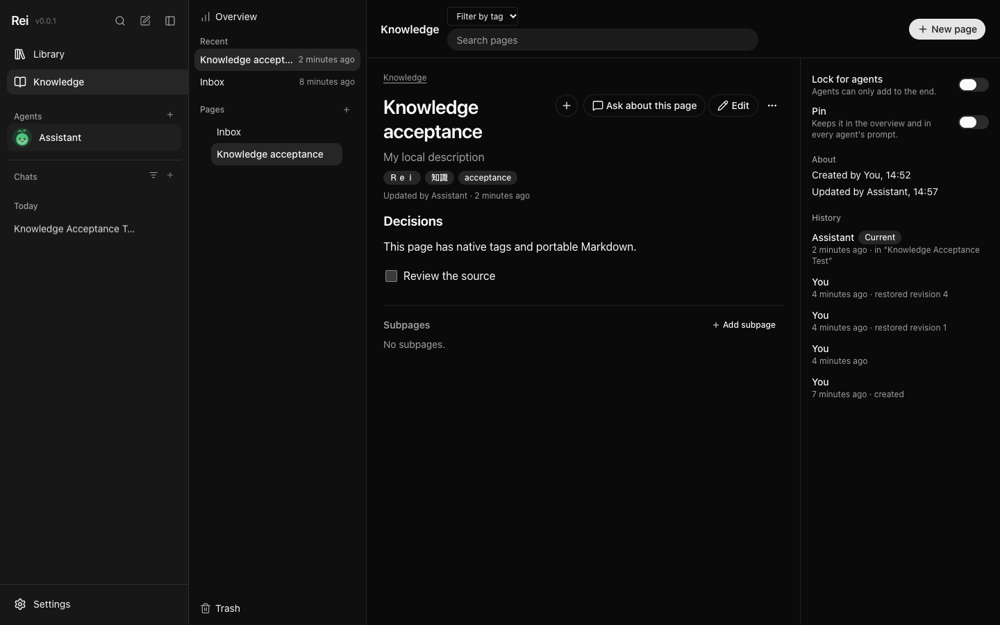
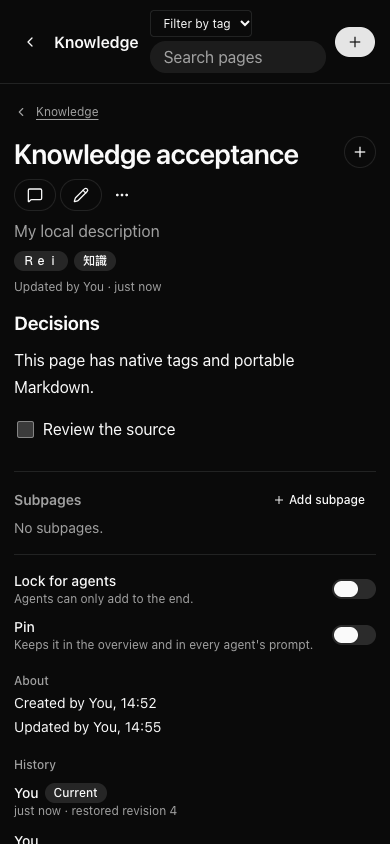
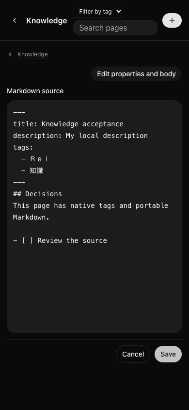
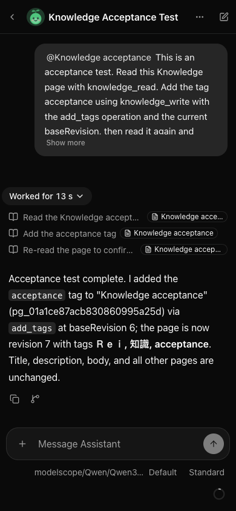

# Knowledge frontmatter validation — 2026-11-12

Implemented the agreed title/description/tags scope. Status and aliases are excluded. See [the interface and operational notes](knowledge-frontmatter.md) and [ADR 0012](adr/0012-knowledge-frontmatter-is-an-interchange-format.md).

## Local checks

`npm run verify` passed: formatting, baseline lint, generated contract consistency, all workspace typechecks, architecture and dependency rules, secret scanning, coverage floors, tests, and production web build. The full run reports 232 passing test files, 3 skipped files, 3,025 passing tests and 19 skipped tests. Existing build warnings report large frontend chunks.

`npm run check:security` found zero vulnerabilities, including development dependencies. `git diff --check` passed.

The skipped environment-dependent suites require `REI_BROWSER_CDP` (real browser driver), `RUN_OFFICE_PREVIEW_TESTS=1` and installed LibreOffice (real Office previews), and `REI_EMBEDDER_URL` (embedding model evaluation). No skips or coverage floors were changed. These optional suites were not enabled for this gate; the separate browser acceptance below used a real Chromium and the deployed app.

Focused regressions cover strict parsing and limits, reserved scalar quoting, Unicode identity, source round-tripping and whitespace, invalid-write rollback, exclusive source input, tag mutation concurrency and locks, grouped revision snapshots/restoration, literal body YAML, trash/purge/suggestions, and both retrieval paths beyond the former global section caps. Frontend tests cover unsaved mode switching, source errors and source-only payloads, conflicts, and filter-only browsing without a meaning badge. Agent tool tests exercise source creation, tag mutations, reading native properties, and tag-only search through the runtime.

## Local deployment and database

The user explicitly authorized database reinitialization. The earlier database was archived under `control-data:/data/db-backups/2026-11-12T06-51-14-221Z/`; SQLite `quick_check` returned `ok`. It contained zero non-system Knowledge pages. Other storage volumes and tree files were preserved. Reinitialization reset the SQLite records and login; setup reused the saved development password, stored only in the ignored `containers/.secrets/dev-login.json` with mode 0600.

Control and edge were rebuilt/recreated on the existing local Docker stack. The deployed control image is `sha256:12b4289601e8b94cec13d07d06a550db75979bff08c97092da58b1fc3bc6154d`, built from `d5e1b45` plus this uncommitted working tree; the browser loaded `index-B9Ji8LMr.js`. The published address remains `127.0.0.1:8787`; no VM was used. The fresh database includes page/revision metadata and the derived tag table and passed `quick_check`. All running stack services reported healthy. The old control image was `sha256:02ec5c5f270e9fa4e4fd01eec9d713b3c1372ac7898635e5d31e9653acb15027`; full application rollback to that image/database was not exercised.

## Live browser acceptance

Used a dedicated agent-browser session with the actual deployed app and saved development login.

- Created a page, edited native properties and Unicode tags, and switched the unsaved draft to source and back without saving.
- Submitted unsupported `status` in source: the app showed a field/line error and preserved the draft; the server rejected the write. The final deployed API returned numeric issue line 3/column 1 for the rejected status field and left revision/body unchanged. A valid source with `Ｒｅｉ` and `rei` deduplicated to one displayed tag.
- Saved and checked the reader: native tags, Markdown body, no generated YAML header leakage.
- Used tag-only filtering and checked AND filtering over HTTP. Exported Markdown and re-imported it; properties and body were preserved exactly. The final deployed API also preserved leading blank lines when saving source onto an empty page. The duplicate acceptance page was subsequently moved to Trash.
- Applied a concurrent HTTP edit while the editor was open. The local description and tags remained intact, review exposed base/latest/local versions, and Save stayed disabled until a deliberate choice. Keeping the local draft and saving succeeded against the latest revision.
- Restored the initial empty revision, confirming properties/body cleared together; restored the later populated revision, confirming both returned.
- Reviewed desktop at 1440 × 900 and mobile at 390 × 844. The mobile reader and source editor had document width 390, matching the viewport; source/property switching remained usable.
- Used “Ask about this page” with the configured real gateway model. The visible trace completed read → add tag → read. The agent used `add_tags` with base revision 6; the saved page advanced to revision 7 with `Ｒｅｉ`, `知識`, `acceptance`. The original title, description and body were retained. This validates one configured provider path, not every provider.

